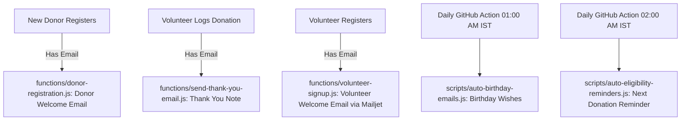

# LifeSavers United - System Flow & Feature Specification

> **MANDATORY DEVELOPER RULE**:  
> Whenever editing, refactoring, or adding any new feature, **YOU MUST READ AND ADHERE TO THIS DOCUMENT FIRST**. Never alter existing database schemas, role permissions, or lifecycle flows without explicitly ensuring backwards compatibility with the rules defined here.

---

## 1. System Overview

**LifeSavers United** (`lifesaversunited.org`) is a community-driven emergency blood coordination platform built for rapid response in India (primarily Gujarat & expanding). It connects patients in acute need of blood with voluntary donors through verified volunteer coordinators.

### Technology Stack Summary
- **Frontend**: Vanilla HTML5, CSS3, JavaScript (ES6 Modules), Tailwind CSS (`css/main.css`).
- **Database & Auth**: Google Cloud Firestore, Firebase Phone Auth (reCAPTCHA v3 & OTP), Firebase App Check.
- **Backend / Serverless**:
  - Cloudflare Pages Functions (`functions/`): Multi-provider email engine (`doctor-signup`, `send-thank-you-email`, `broadcast-email`, etc.).
  - Firebase Cloud Functions (`firebase-functions/`): Telegram bot webhook, user processing.
  - GitHub Actions Workflows (`.github/workflows/`): Automated daily cron jobs for Birthday and Next Eligible Date reminders.
  - Python Local Dev Server (`server.py`): CORS-aware proxy and Apps Script forwarder.

---

## 2. User Roles & Permission Matrix

The platform recognizes **4 core user types**, controlled by the user's `role` and `status` in Firestore:

| User Type | Role in DB | Status in DB | Access Level & Capabilities |
| :--- | :--- | :--- | :--- |
| **Public Guest** | None | N/A | • Submit Blood Requests • Register as Donor • Access public tools (Eligibility Calculator, Health Assessment) • Apply as Volunteer or Doctor |
| **Donor** | `donor` | `approved` | • Access **Donor Portal** (`donor_portal.html`) • View all donations (verified & self-reported) • Self-report past donations (add/edit/delete self-logs) • Download Official Certificate of Appreciation • Download/share "Proud Donor" Hero Poster & Card • Toggle Emergency Availability & Temporary Rest |
| **Volunteer (Approved)** | `volunteer` | `approved` | • Coordinator Dashboard (`emergency_request_system.html`) • Verify & edit Blood Requests • Search & contact Donors (`donors.html`) • Log official donations for donors/requests • View All Requests, Donors, and Donation Logs (`donation_logs.html`) ❌ *Cannot edit/delete core donor profiles or verified logs* |
| **Admin / Super User** | `superuser` | `approved` | • Everything an Approved Volunteer can do • **Edit any Donor details** & permanently delete Donors • **Edit and delete any Donation Log** • Manage users (Approve/Reject pending volunteers, change roles) • Emergency Request Broadcast tool (Bulk WhatsApp/SMS) |

> **Note on New Volunteer Signups:** Any new account created via Phone Auth defaults to `{ role: 'volunteer', status: 'pending' }` unless they already match a donor's phone number. They **cannot** access coordinator dashboards until a Superuser changes their status to `approved`.

---

## 3. End-to-End User Journeys (With Real Examples)

### Journey A: Public Emergency Blood Request & Fulfillment Flow
> **Example Scenario**: Ramesh needs 2 units of `B+` blood for his sister Anita admitted at Civil Hospital, Ahmedabad.

1. **Submission (Public)**:
   - Ramesh visits `emergency_blood_request.html`.
   - Fills in: Patient Name (*Anita*), Blood Group (*B+*), Units (*2*), Hospital (*Civil Hospital, Ahmedabad*), Urgency (*Critical*), Contact Person & Phone (*9876543210*).
   - Form validates 10-digit phone number and checks for duplicate open requests.
   - The request is saved to `emergency_requests` collection with status: `pending`.
   - A real-time notification is pushed to Telegram / Volunteer alerts.

2. **Verification (Volunteer / Coordinator)**:
   - Volunteer Priya logs in with OTP, opens `emergency_request_system.html`.
   - Reviews Anita's pending request, calls Ramesh to verify genuineness (doctor's slip / requisition confirmed).
   - Priya clicks **"Verify Request"** ➔ Status updates to `verified` / `in-progress`.
   - If needed, Priya generates an official Shareable Poster (1080x1080 PNG) to circulate on WhatsApp volunteer groups.

3. **Donor Matching**:
   - Priya opens `donors.html`, filters by Blood Group: `B+`, City: `Ahmedabad`, Availability: `Available for Emergency`.
   - The system displays matching eligible donors (excluding those in 90-day post-donation rest).
   - Priya clicks WhatsApp or Call to reach donor Vikram. Vikram agrees to donate at Civil Hospital.

4. **Donation Logging & Thank You Flow**:
   - After donation, Priya opens Vikram's profile in `donors.html` or clicks **"Mark Fulfilled & Log Donation"** in `emergency_request_system.html`.
   - Submits: Units (*1*), Type (*Whole Blood*), Hospital (*Civil Hospital*), Patient (*Anita*).
   - **System actions triggered immediately**:
     - Creates an immutable record in `donation_logs` with `status: 'verified'` and `verifiedBy: Priya`.
     - Updates Vikram's `lastDonatedAt` timestamp in `donors` collection.
     - Automatically resets Vikram's availability to "Resting / Cooldown" for 90 days.
     - Updates the blood request status to `fulfilled`.
     - **Automated Thank You Email Trigger**: If Vikram has an email registered, the system invokes `/send-thank-you-email`. Vikram receives a thank-you note highlighting his life-saving impact.

---

### Journey B: Donor Onboarding & Self-Service Experience
> **Example Scenario**: Sneha wants to become a registered voluntary blood donor.

1. **Registration**:
   - Sneha visits `donor_registration.html`.
   - Inputs: Name (*Sneha Patel*), Phone (*9825012345*), Blood Group (*O+*), City (*Ahmedabad*), Gender (*Female*), Email (*sneha@example.com*).
   - Accepts the voluntary consent.
   - Submits ➔ Record saved to `donors` collection.
   - **Instant Gratification**: A popup appears with her customized **"Proud Donor" 1080x1080 Poster** with her name and blood group. Sneha can download it or share it directly to WhatsApp status.
   - **Welcome Email Trigger**: An automated welcome email is dispatched to `sneha@example.com` with guidance and donor FAQs.

2. **Accessing the Donor Portal**:
   - Later, Sneha visits `donor_portal.html` and logs in using OTP on `9825012345`.
   - The system recognizes her phone number in the `donors` collection and logs her in as `role: 'donor'`.

3. **Managing Past Donations (Self-Reporting)**:
   - Sneha previously donated blood at a local camp 6 months ago before joining LifeSavers United.
   - In her portal under **"Donation History"**, she clicks **"Add Past Donation"**.
   - Fills in: Date, Donation Type (*Whole Blood*), Units (*1*), Hospital/Camp name.
   - The system saves this to `donation_logs` with `source: 'donor_self_reported'` and `status: 'self_reported'`.
   - Sneha can edit or delete this self-reported log anytime if she made a typo.

4. **Downloading Official Certificate of Appreciation**:
   - Once Sneha has a verified donation recorded by a coordinator, she clicks **"📜 Certificate"**.
   - An official high-resolution Certificate of Appreciation is rendered via HTML5 Canvas using `imgs/certificate-template.png` with her name, date, unique Certificate ID (`LSU-YYYYMM-XXX`), and official signature.
   - Downloads directly as a high-quality `.png`.

5. **Managing Availability / Rest Period**:
   - If Sneha is traveling or feeling unwell, she flips the toggle in her portal to **"Temporary Rest / Snooze"**.
   - Coordinators will now see her marked as resting and will not disturb her during emergencies until she turns it back on or her rest date expires.

---

### Journey C: Superuser Management & Emergency Broadcast
> **Example Scenario**: An emergency arises requiring 10 units of rare `AB-` blood across Ahmedabad due to a multi-casualty accident.

1. **Broadcast Tool**:
   - Superuser Nikunj logs in, opens `emergency_request_system.html` or the Broadcast Panel.
   - Filters: Blood Group `AB-`, Location `Ahmedabad`.
   - System fetches all registered active `AB-` donors who are not currently on a 90-day cooldown.
   - Superuser composes a high-priority emergency alert message and triggers the broadcast.
   - Broadcast activity is logged to `broadcast_logs` (read/create superuser only; immutable).

2. **Data Governance & Error Correction**:
   - If a donor enters their blood group incorrectly or requests profile removal, only a **Superuser** can open the Donor Edit modal and update medical info or delete the donor profile.
   - If a volunteer entered an incorrect unit count or wrong hospital during donation logging, only a **Superuser** has the **"Edit Log"** and **"Delete Log"** buttons to correct the audit log.

---

## 4. Automated Notification & Email Engine

All transactional and automated communications use our **3-Provider Round-Robin Rotation Engine** (`functions/_email-sender.js`):
- **Providers**: Resend (100/day free) ➔ Brevo (300/day free) ➔ Mailjet (200/day free).
- **Combined free capacity**: ~600 automated emails/day at zero cost with seamless fallback if one provider hits rate limits.

### Summary of Email Triggers

1. **Donor Welcome Email**:
   - **Trigger**: Immediately upon public donor registration if email provided.
   - **File**: `functions/donor-registration.js`.

2. **Volunteer Welcome Email**:
   - **Trigger**: Immediately upon volunteer form submission if email provided. Dispatched via Mailjet.
   - **File**: `functions/volunteer-signup.js`.

3. **Thank You Email**:
   - **Trigger**: Triggered via frontend `fetch('/send-thank-you-email')` when a coordinator/volunteer logs a donation.
   - **File**: `functions/send-thank-you-email.js`.

3. **Daily Birthday Emails**:
   - **Schedule**: Every day at **19:30 UTC** (01:00 AM IST).
   - **Workflow**: `.github/workflows/birthday-emails.yml`.
   - **Script**: `scripts/auto-birthday-emails.js`.
   - **Logic**: Queries `donors` where date of birth matches today (`MM-DD`). Sends personalized greeting and sends daily execution report to NGO admins.

4. **Daily Next Eligible Date Reminder Emails**:
   - **Schedule**: Every day at **20:30 UTC** (02:00 AM IST).
   - **Workflow**: `.github/workflows/eligibility-reminders.yml`.
   - **Script**: `scripts/auto-eligibility-reminders.js`.
   - **Logic**: Calculates `lastDonatedAt + 90 days (Whole Blood)`. If eligible today, sends invitation to donate again.

---

## 5. Core Data Architecture (Firestore Collections)

### `donors`
- `fullName` *(string)*: Full legal/display name.
- `contactNumber` *(string | number)*: 10-digit mobile number (normalized).
- `bloodGroup` *(string)*: `A+`, `A-`, `B+`, `B-`, `AB+`, `AB-`, `O+`, `O-`.
- `city` *(string)*: City of residence.
- `email` *(string, optional)*: Email for certificates & updates.
- `dateOfBirth` / `dob` *(string/timestamp)*: Used for birthday automation (`YYYY-MM-DD`).
- `gender` *(string)*: `Male`, `Female`, `Other`.
- `isEmergencyAvailable` *(boolean)*: Availability for emergency calls.
- `temporaryRest` *(object/timestamp, optional)*: Snooze expiry date if temporarily unavailable.
- `lastDonatedAt` *(timestamp, optional)*: Date of most recent donation.
- `totalDonations` *(number)*: Count of completed donations.
- `lastHeroMilestone` *(number, optional)*: Last saved/customized milestone count for Hero Appreciation Cards.
- `registeredAt` *(timestamp)*: Server timestamp of registration.

### `emergency_requests`
- `patientName` *(string)*: Patient requiring blood.
- `bloodGroup` *(string)*: Requested blood group.
- `units` *(number)*: Number of units required.
- `hospital` *(string)*: Hospital name and branch.
- `city` *(string)*: City where hospital is located.
- `urgency` *(string)*: `critical` (immediate), `urgent` (within 24h), `normal`.
- `contactPerson` *(string)*: Attendant / requester name.
- `contactNumber` *(string)*: 10-digit contact number.
- `status` *(string)*: `pending` ➔ `verified` ➔ `in-progress` ➔ `fulfilled` / `closed`.
- `createdAt` *(timestamp)*: Submission timestamp.
- `verifiedBy` *(string, optional)*: Coordinator name/UID who verified.

### `donation_logs`
- `donorId` *(string)*: Firestore Document ID in `donors`.
- `donorName` *(string)*: Donor name snapshot.
- `donorContact` *(string)*: Normalized phone number.
- `patientName` *(string, optional)*: Patient who received the blood.
- `hospital` *(string)*: Hospital or blood bank where donation occurred.
- `donationType` *(string)*: `Whole Blood`, `Platelets (SDP)`, `Plasma`, `Double Red Cells`.
- `unitsDonated` *(number)*: Number of units (default 1).
- `timestamp` / `donatedAt` *(timestamp)*: Date of donation.
- `source` *(string)*: `coordinator_verified` or `donor_self_reported`.
- `status` *(string)*: `verified` or `self_reported`.
- `verifiedBy` *(string, optional)*: Coordinator display name (absent on self-reported logs).

### `users`
- `uid` *(string)*: Firebase Auth UID.
- `phoneNumber` *(string)*: Authenticated phone number.
- `displayName` *(string)*: User name.
- `role` *(string)*: `donor`, `volunteer`, `superuser`.
- `status` *(string)*: `pending`, `approved`, `rejected`.
- `lastLogin` *(timestamp)*: Updated upon sign-in.

---

## 6. Critical Developer Rules & Constraints

1. **Reference This Spec First**: Before altering any logic in `scripts/`, `functions/`, or `.html` files, cross-check this document to confirm which roles and downstream events are affected.
2. **Never Break CSS Rules**: Follow the project's strict convention:
   - **No inline styles or `<style>` tags in HTML files**.
   - All styles must be in external `.css` files.
   - When building Tailwind CSS, always run `npm run build:css` (which runs `@dhiwise/component-tagger` first).
3. **10-Digit Phone Normalization**: Always strip `+91`, `91`, leading zeros, and whitespace when comparing or saving mobile numbers.
4. **App Check Protection**: Public write operations (`emergency_requests`, `donors`, `donation_logs`) rely on Firebase App Check (`isVerifiedApp()`). Never bypass App Check initialization in new scripts.
5. **Separation of Verified vs Self-Reported Logs**: Never allow a donor to set `verifiedBy` or update `status` to `verified` on their own. Certificates must only be issued for verified donations.
6. **Audit Safety**: Volunteers can log donations, but only **Superusers** can delete donors or modify historical donation logs.
7. **Mandatory Confirmation Before Implementation**: Whenever asked to implement, edit, or modify code, the AI must never immediately write code. It must first state its exact understanding of the request, explain what it plans to do, and wait for explicit user confirmation before executing.
